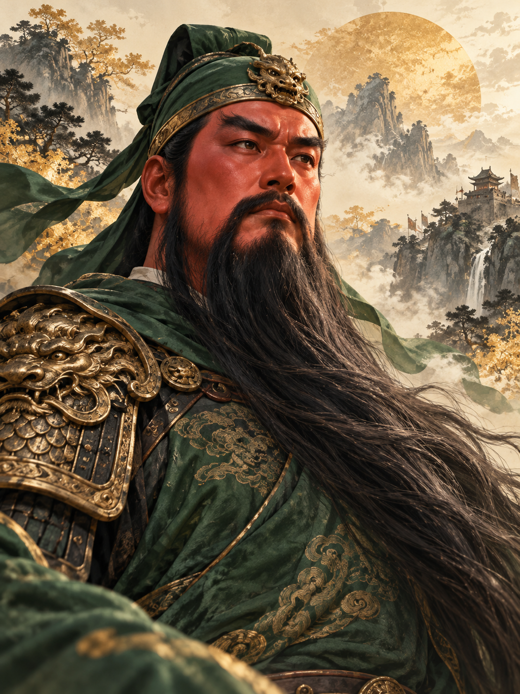

# LVRAG

**LongerVision Retrieval-Augmented Generation**

面向文化 IP 与智能终端的 AI 知识交互项目。

## 项目简介

LVRAG 致力于将文化知识、故事内容与智能交互相结合，探索自然、可靠、可扩展的 AI 体验。项目支持嵌入式终端与在线知识服务的协作，关注知识准确性、用户体验和可持续运营。

**首个文化主题：关公（Guan Gong / Guan Yu）。**

关公主题将围绕历史记载、文学故事与传统文化展开。项目将明确区分史实、文学演绎和原创内容，努力提供有依据、易理解的文化讲述。

## 方向

- **文化知识交互：** 面向故事讲述与知识问答的自然交流。
- **离线与在线协作：** 基础内容可在设备端使用，联网后获得更丰富的知识服务。
- **多终端支持：** 首个嵌入式目标为 [XiaoXiang ESP32-S3](https://github.com/LongerVisionRobot/xiaoxiang-esp32s3)。
- **开放扩展：** 逐步探索更多文化主题与应用场景。

## 项目状态

**早期研发阶段。** 本仓库目前用于建立项目基础，具体功能、支持范围与发布时间以后续正式发布为准。

## 联系与归属

项目组织：[LongerVisionCanada](https://github.com/LongerVisionCanada)

## 许可与素材

软件许可、知识内容授权与形象素材使用条款尚待确定。在正式公布许可之前，不应推定本仓库内容已获得任何特定开源许可或商业再利用授权。
